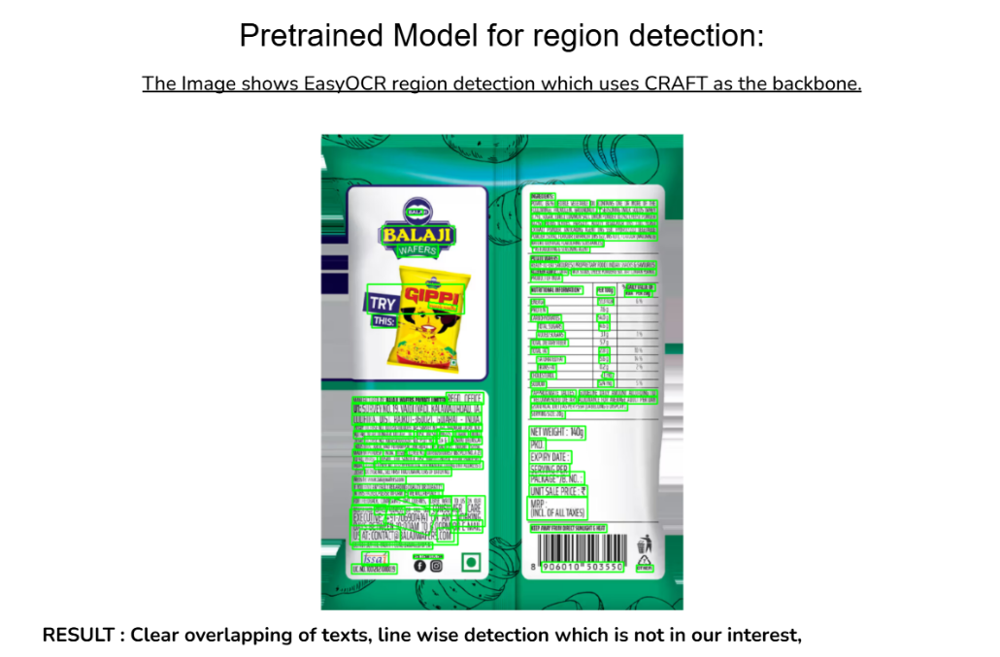
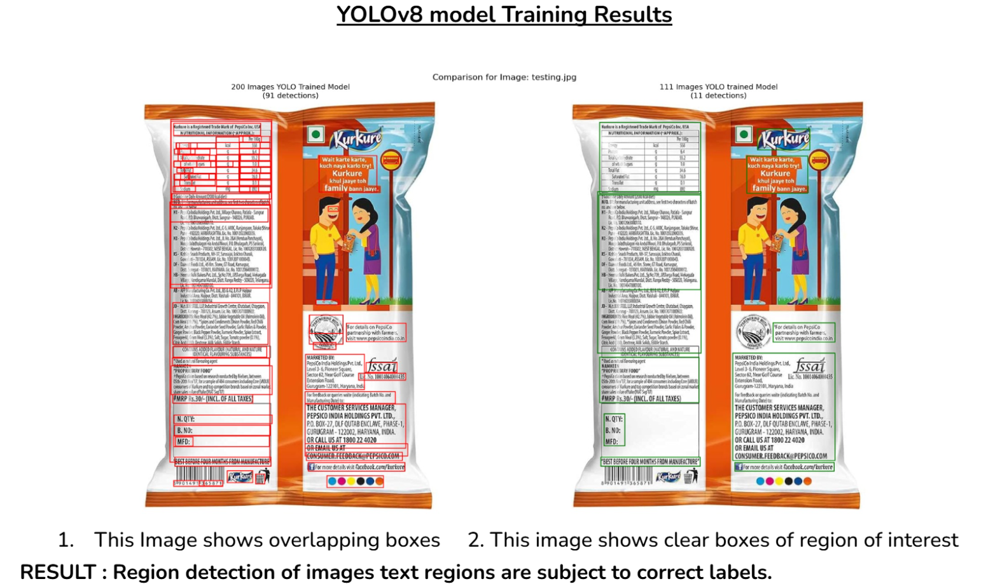

# Ingredient Extraction Pipeline

React interface and FastAPI service for YOLO text detection, PaddleOCR transcription,
and ingredient identification with Groq through LangChain. Supports custom prompts, annotated images,
and JSON exports.

## Setup (PowerShell)

Use Python 3.10+ and a Node.js version supported by Vite 8.

```powershell
python -m venv backend/venv
backend/venv/Scripts/python -m pip install -r backend/requirements-dev.txt
Copy-Item backend/.env.example backend/.env
```

Set `GROQ_API_KEY` in `backend/.env`. `GROQ_MODEL` defaults to
`openai/gpt-oss-20b`. `CORS_ORIGINS` lists allowed frontend origins.

Start the backend:

```powershell
cd backend
venv/Scripts/python run.py
```

In a second terminal:

```powershell
cd frontend
npm ci
npm run dev
```

Vite proxies API requests to port 8000. Production hosting must route `/extract`,
`/postprocess`, and `/health` to the backend. YOLO weights are included in
`backend/app/models/best.pt`. PaddleOCR may download pretrained models on first use.
Models load lazily, so the first extraction takes longer. OCR remains available
when the Groq key is missing or the provider fails.

## Architecture

- `frontend/src/app/`: application shell and page navigation.
- `frontend/src/pages/home/`: product overview, sample package, and keyboard-accessible walkthrough.
- `frontend/src/pages/extract/`: upload workspace, zoomable image, ingredient results, and chat.
- `frontend/src/styles/`: shared design tokens, typography, base styles, and vendor adapters.
- `frontend/src/components/ui/`: reusable controls and surfaces.
- `frontend/src/components/layout/`: header, feedback, and footer.
- `frontend/src/hooks/`: request state, cancellation, image geometry, chat scrolling, and clipboard lifecycle.
- `frontend/src/services/`: HTTP transport, extraction preparation, annotations,
  image validation, and response normalization.
- `frontend/src/utils/`: shared download helpers.
- `backend/app/api/routes.py`: HTTP input validation and response codes.
- `backend/app/images.py`: image header checks and decoding before inference.
- `backend/app/schemas.py`: typed request and response contracts.
- `backend/app/services.py`: lazy model lifecycle and serialized predictor access.
- `backend/app/pipeline/`: detection, OCR, Groq adapters, and orchestration.
- `backend/app/config.py`: environment and application settings.

The extraction screen starts with upload controls and a Comet Dial for confidence.
During extraction a page overlay uses Thought Line; the labelled image and results
appear when the request finishes. Hold the clear button for 1.2 seconds to reset.
Results use Animated List, Glide Select, Prompt Bar, and accessible Motion-backed tabs.
The image viewer uses react-zoom-pan-pinch for scroll, pinch, and drag controls.
Motion animates larger cursors arriving from screen edges, then dragging each
detection from its top-left to its bottom-right corner. Replay restarts the draw;
zooming or panning completes the overlay so annotations stay attached to the image.
The AI chatbot tab answers label questions with bounded conversation
context. Pulse Heart and Peek Rating start at zero and keep feedback only in the
current page session. Vendored components and their license are in
`frontend/src/components/reactbits/`.

Default extraction requests translations in English (`en`), Hindi (`hi`), Spanish
(`es`), French (`fr`), German (`de`), and Arabic (`ar`). The `translations` object
maps language codes to arrays matching ingredient order and count. All six
languages are required by the backend schema; invalid responses are retried once.
The selector always lists every language. Selecting a missing translation in an
existing extraction requests fresh multilingual output without rerunning OCR.

The home page is `/#/`; ingredient extraction is `/#/extract`. The legacy
`/#/workspace` link remains supported. Navigating between pages preserves the
current extraction. Chatbot results stay separate from the original ingredient result.
The main result and its exports show ingredients; OCR regions remain internal to
the pipeline and API. The walkthrough supports direct selection and keyboard navigation.
The frontend uses a shared light design system and self-hosted typography; see
`frontend/docs/design-system.md` for implementation notes.

Images remain in memory. There is currently no database, extraction history, or persistence layer.
Default LLM output is validated with a Pydantic ingredient schema through LangChain;
custom prompts retain flexible JSON objects. Invalid output returns an error while
preserving OCR regions. Prompt templates keep OCR data separate from instructions.

Uploads are limited to 10 MB and decoded images to
25 million pixels. YOLO uses the selected confidence threshold and returns actual
confidence and class metadata. Shared predictor access is serialized per process;
blocking extraction runs in a worker thread. Higher throughput needs dedicated
model workers.

## API

- `GET /health`: process liveness, without loading models or checking providers.
- `POST /extract`: multipart `file`, `confidence` (0.1-0.9, default 0.45), and
  optional `custom_prompt`. Returns `detected_regions` and `llm_post_process`.
- `POST /postprocess`: JSON `ocr_results` and optional `custom_prompt`, without
  rerunning OCR. Each region has `box_id`, `bbox`, `text`, `confidence`, `class_id`.

Invalid inputs return 400/422, large images 413, and unavailable extraction 503.
LLM failures appear in the result's `error` field, preserving OCR output. The LLM
`structured` output is a JSON object whose fields may vary with custom prompts.

## Validation

```powershell
cd backend
venv/Scripts/python -m unittest discover -s tests -v
cd ../frontend
npm run build
npm run lint
npm test
```

Frontend tests include React hooks in JSDOM, cancellation, file validation,
annotation failures, multilingual exports, chat context, and keyboard navigation. Backend tests cover HTTP validation,
image limits, model lifecycle, and provider failures. Tests mock inference and
provider calls; model accuracy requires real package
images. `pipeline.ipynb` preserves the Colab experiments. The historical research
notes below describe earlier models; runtime model selection uses `GROQ_MODEL`.

## Research notes

### Video Demonstration

[Watch the Video Demonstration on Google Drive](https://drive.google.com/file/d/1M43hXeyu1G7LP0-KyQ6SvC2iYv7IlN2z/view?usp=sharing)

<video src="./assets/videoDemo.mp4" controls="controls" style="max-width: 100%;">
  Your browser does not support the video tag. <a href="https://drive.google.com/file/d/1M43hXeyu1G7LP0-KyQ6SvC2iYv7IlN2z/view?usp=sharing">Click here to watch the demo</a>.
</video>

## 🎯 What Are We Doing?

Our objective is to build a robust, automated pipeline capable of extracting structured ingredient lists from product images. Real-world product packaging often contains complex backgrounds, varied lighting, and distorted text. To tackle this, we are developing a multi-stage system that first detects where the text is located, accurately transcribes that text, and then uses a Large Language Model (LLM) to semantically identify and format the actual ingredients from the raw text.

## 🔄 The Pipeline

The ingredient extraction process follows a structured 8-step pipeline:

1. **Text Region Detection:** YOLO11n (custom trained on our dataset).
2. **ROI Extraction:** OpenCV Cropping using the bounding boxes predicted by YOLO.
3. **OCR Recognition:** PaddleOCR applied directly on each cropped region for accurate character transcription.
4. **OCR Text Aggregation:** Merging OCR lines into one cohesive paragraph per YOLO box.
5. **Structured OCR Output:** Generating raw JSON containing the transcribed text.
6. **Ingredient Region Identification:** Using Llama 3.3 70B (via Groq API) to semantically identify the ingredients.
7. **Ingredient Extraction:** Rule-based / NLP extraction (next step).
8. **Final JSON Output:** Final structured data ready for Database / API / Export.

## 🛠️ Discussing the Pipeline

Our pipeline was designed to handle the complexities of real-world product packaging through a carefully evaluated sequence of computer vision and NLP models.

### Dataset Preparation & Pre-processing
Detecting text on distorted and highly textured packaging requires a robust dataset. We manually annotated a custom dataset, eventually scaling it to hundreds of samples (Train: 259, Validation: 55, Test: 57). To optimize text visibility before detection, we evaluated various image pre-processing techniques, including Grayscale conversion, Blurring, CLAHE, OTSU, and Adaptive Thresholding.

### Model Selection: Why YOLO?
During the architectural design phase, we compared several object detection frameworks, including EasyOCR (using the CRAFT backbone) and Faster R-CNN. 

While Faster R-CNN (a two-stage Region Proposal Network) provided slightly higher accuracy in some isolated cases, we ultimately selected **YOLO** because it is a fast, one-stage object detector that offers a much faster interface and state-of-the-art performance for real-time applications. To maximize efficiency without training from scratch, we utilized **Transfer Learning**—finetuning the pretrained features of the highly optimized **YOLOv11n** architecture on our specific text detection task.

*(Note: We also experimented with layer freezing during training, but found it did not significantly impact the final performance outcomes.)*

### End-to-End Integration
The complete pipeline bridges computer vision and natural language processing. Once YOLO isolates the text regions, the bounding boxes are cropped and passed to **PaddleOCR** for high-accuracy character transcription. Finally, this unstructured, aggregated text is fed into **Llama 3.3 (via the Groq API)**, which intelligently parses the raw string into a structured JSON list of ingredients.

## 📊 Results

Our model improved significantly as we scaled our dataset and transitioned from YOLOv8 to YOLO11n.

**Initial Training Results (111 images, YOLOv8n):**
- Precision: 0.636
- Recall: 0.698
- mAP50: 0.704
- mAP50-95: 0.483

**Final Training Results (YOLOv11n with 259 Train / 55 Val / 57 Test samples):**
- **Precision:** 0.8516 *(Out of all detected regions, 85% were actually text)*
- **Recall:** 0.7713 *(77% of all actual text was successfully detected)*
- **mAP50:** 0.8538 *(Mean Average Precision at IoU threshold $\ge 0.5$)*
- **mAP50-95:** 0.6711 *(Average mAP across IoU thresholds from 0.5 to 0.95)*
- **mAP75:** 0.7485

### Visual Results

Here are visual demonstrations of our pipeline in action:




